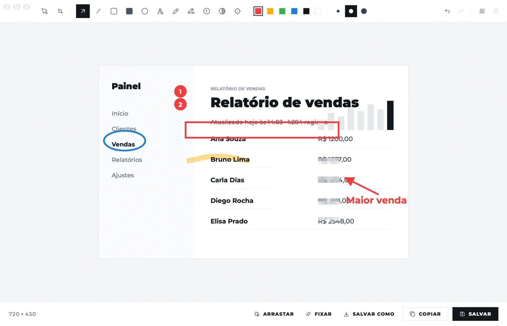
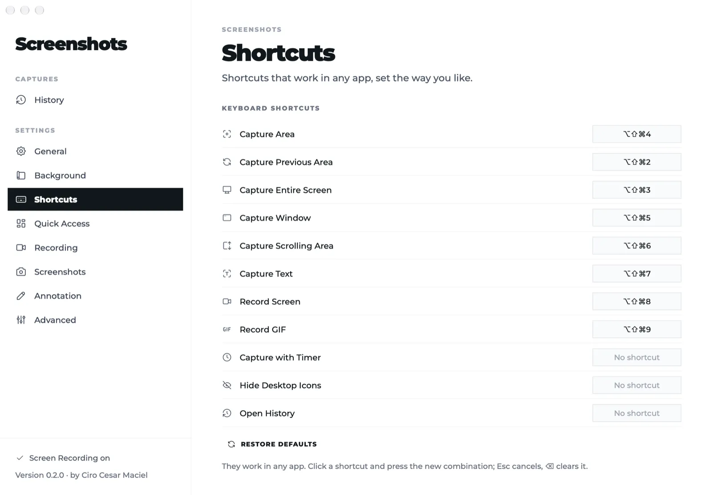

# Screenshots by Ciro Cesar Maciel

**An open screenshot and screen recording app for the Mac, in the spirit of CleanShot X.**

One of [six free, open-source Mac apps](#more-from-ciro-cesar-maciel) by [Ciro Cesar Maciel](https://ciromaciel.click/?ref=oss-screenshots).

**[Watch the 1-minute video](https://youtu.be/oDOndh6FLTs)**

[](https://www.opensourcealternatives.to)

Capture an area, a window, the full screen or a long scrolling page, pull the text out of an image, record the screen as MP4 or GIF, then annotate, pin or drag the result into another app. It lives in the menu bar, and everything stays on your Mac: there is no network code in the app. A native Swift app for macOS 14+ on Apple Silicon.

[Português](README.pt-BR.md)



## Install

```bash
curl -fsSL https://blob.ciromaciel.click/tools/screenshots/install.sh | bash
```

The script downloads the latest `.dmg`, copies Screenshots to `/Applications` and opens it.

With [Homebrew](https://github.com/ciro-maciel/homebrew-tap): `brew install --cask ciro-maciel/tap/ciro-screenshots`.

Prefer the disk image? [Download Screenshots-macos.dmg](https://blob.ciromaciel.click/tools/screenshots/latest/Screenshots-macos.dmg). Open it and drag Screenshots to Applications. It is signed with Developer ID and notarized by Apple, so macOS opens it with no warning.

On the first run, turn on Screenshots in **System Settings → Privacy & Security → Screen & System Audio Recording**. The welcome window takes you there; once it is on, its button reopens the app, because macOS grants the permission to a fresh process only.

## What it does

| Feature | Default shortcut | How it works |
| --- | --- | --- |
| Capture area | ⌥⇧⌘4 | The screen freezes; crosshair, magnifier and size. Shift makes a square, a click takes the whole screen, Space switches to window, Esc cancels |
| Previous area | ⌥⇧⌘2 | Repeats the last rectangle |
| Full screen | ⌥⇧⌘3 | The screen under the mouse, at native resolution |
| Window | ⌥⇧⌘5 | Just the window, with or without its shadow, on an optional background |
| Scrolling capture | ⌥⇧⌘6 | You scroll (or "scroll by itself", which needs Accessibility); the frames are stitched and fixed headers and footers appear once |
| Text from the screen | ⌥⇧⌘7 | Recognizes the text in an area with Apple's Vision framework, on device, and copies it |
| Record screen / GIF | ⌥⇧⌘8 / ⌥⇧⌘9 | H.264 MP4 with optional system audio and microphone, visible clicks and a 3-second countdown; the GIF is made from the video |
| Timer | menu | 3, 5 or 10 seconds after you pick the area |
| Quick Access | | A thumbnail in the corner: copy, save, annotate, pin, delete, or drag it into another app |
| Annotation editor | | Arrow, line, rectangle, filled rectangle, ellipse, text, pencil, highlighter, counter, blur, spotlight, crop and a background with margin; undo, ⌘C, ⌘S, ⇧⌘S |
| Pin to screen | | The image floats above every window; move, resize, change opacity, Esc closes |
| History | menu | Every capture, kept from one day to forever, as you choose |
| Hide desktop icons | menu | Covers the icons with the wallpaper; the Finder is not touched |

Every shortcut can be changed in Settings. They are registered with Carbon's `RegisterEventHotKey`, so they don't need Accessibility.



## How it is built

- Swift, AppKit and SwiftUI, compiled by `swiftc`: no Xcode project, no package manager, no dependencies.
- Capture with ScreenCaptureKit. The app's own windows (the selection layer, Quick Access, the recording bar) are left out of every capture.
- Scrolling capture (`Sources/Screenshots/Capture/Stitcher.swift`) compares rows with a tolerance, because consecutive frames carry color noise, and ignores the edges, where scroll bars and rounded corners live. The stitched rows go to a file that is memory-mapped, so a long page doesn't grow the memory.
- Recording uses a small pool of 4:2:0 frames, a 4K ceiling and a fragmented MP4, so memory stays flat however long you record.
- No network code: no `URLSession`, no sockets. Opening a file or System Settings goes through `NSWorkspace`.

## Build it yourself

You need the Xcode Command Line Tools. Xcode itself is optional.

```bash
git clone https://github.com/ciro-maciel/screenshots.git
cd screenshots
scripts/build.sh                 # dist/Screenshots.app
open dist/Screenshots.app
```

`scripts/build.sh` signs with a Developer ID Application certificate when your keychain has one (the official build does), with the hardened runtime. Otherwise run `scripts/signing-identity.sh` once: it creates a local signing certificate, and with it the Screen Recording permission survives each rebuild. Without either, the build is signed ad hoc and macOS asks again every time.

The illustrations in the welcome and history windows come from a licensed gallery and ship only in the official build; a build from this repository draws a Tabler icon in their place. To use your own, drop 560 × 560 PNGs named `camera`, `access` and `editor` into `Resources/Illustrations`.

Tests run on an invisible virtual display, so you keep working while they drive real mouse and keyboard events:

```bash
scripts/test.sh e2e /tmp/e2e      # end to end: every capture mode, the editor tools, OCR, MP4 and GIF, with pixel checks
scripts/test.sh memtest           # memory ceilings: captures, editor, scrolling and one minute of recording
dist/Screenshots.app/Contents/MacOS/Screenshots --screenshots /tmp/screens   # a PNG of every window
```

Run them from a terminal that already has Screen Recording. Never run `--e2e` directly, without the script: its test windows would open on your screen.

## Limits

- Apple Silicon and macOS 14 or newer only. Recording the microphone needs macOS 15.
- The interface is in English and Brazilian Portuguese, following the Mac's language.
- No cloud upload or share links, no webcam overlay, no video trimming and no dark mode.

## Contributing

Issues and pull requests are welcome. See [CONTRIBUTING.md](CONTRIBUTING.md).

## License

[MIT](LICENSE). Fonts and icons keep their own licenses: see [NOTICE](NOTICE). CleanShot X is a product of its own makers; this project is not affiliated with it.

---

## More from Ciro Cesar Maciel

I build software on my own, with a team of AI agents, and open what I can. Six native Mac apps, all free, MIT, signed and notarized by Apple, in English and Brazilian Portuguese: [Cleaner](https://github.com/ciro-maciel/cleaner), the Mac cleaner that shows you everything before it deletes anything · [Screenshots](https://github.com/ciro-maciel/screenshots), capture, annotate and record the screen, with nothing leaving your Mac (this one) · [Speech to Text](https://github.com/ciro-maciel/speech-to-text), dictation by shortcut, with Whisper running on your Mac · [Assistant](https://github.com/ciro-maciel/voice-assistant), Claude Code by voice · [Windows](https://github.com/ciro-maciel/windows), snap windows into place with a shortcut or by dragging them to the edge · [Text to Speech](https://github.com/ciro-maciel/text-to-speech), select text in any app and hear it read aloud.

Beyond the apps: [free tools for the browser](https://ciromaciel.click/tools?ref=oss-screenshots), [books](https://ciromaciel.click/books?ref=oss-screenshots), and [Infrastructure](https://myinfrastructure.click/?ref=oss-screenshots), the infrastructure AI agents already know how to run.

**Follow along.** [Follow @ciro-maciel](https://github.com/ciro-maciel) for the next open-source apps, click **Watch → Custom → Releases** above for every new version, and see how it is all made on [YouTube](https://www.youtube.com/@ciro-maciel) and at [ciromaciel.click](https://ciromaciel.click/?ref=oss-screenshots).
