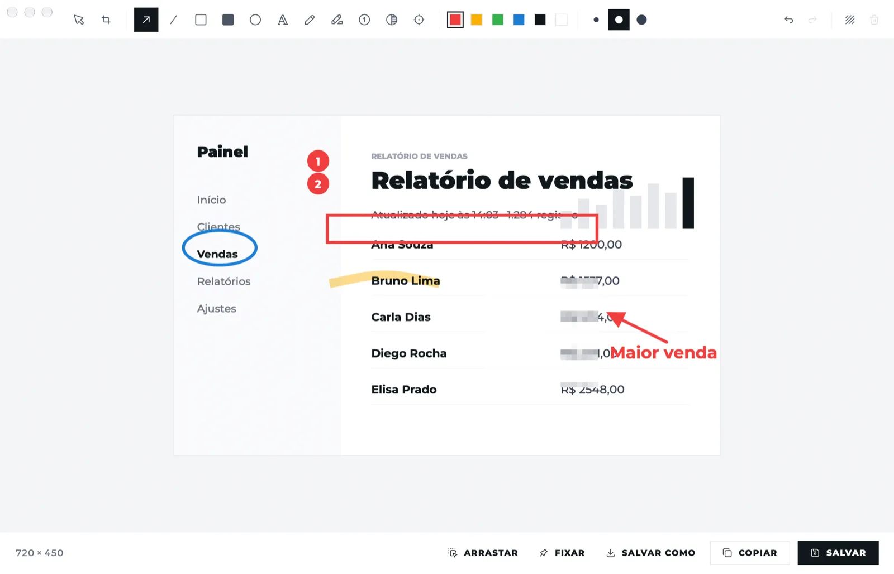
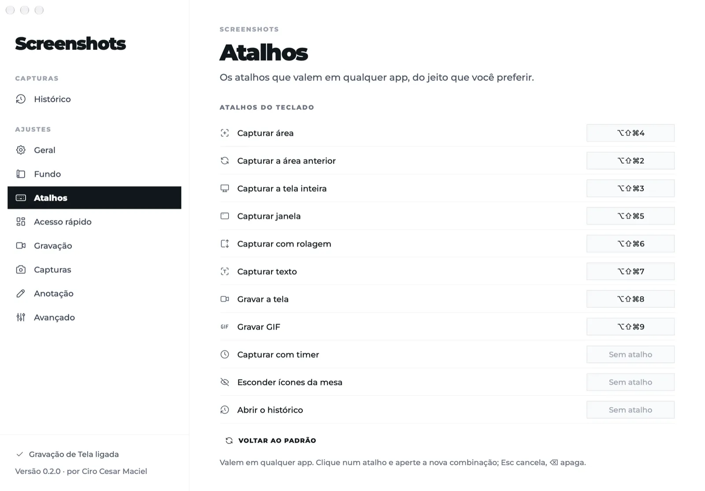

# Screenshots by Ciro Cesar Maciel

**Um app aberto de captura e gravação de tela para Mac, no espírito do CleanShot X.**

Capture uma área, uma janela, a tela inteira ou uma página longa com rolagem, tire o texto de uma imagem, grave a tela em MP4 ou GIF e depois anote, fixe na tela ou arraste o resultado para outro app. Ele mora na barra de menus e tudo fica no seu Mac: o app não tem código de rede. App nativo em Swift para macOS 14 ou mais novo, em Apple Silicon.

[English](README.md)



## Instalar

```bash
curl -fsSL https://blob.ciromaciel.click/tools/screenshots/install.sh | bash
```

O script baixa o `.dmg` mais novo, copia o Screenshots para `/Applications` e abre o app.

Prefere a imagem de disco? [Baixe o Screenshots-macos.dmg](https://blob.ciromaciel.click/tools/screenshots/latest/Screenshots-macos.dmg). Abra e arraste o Screenshots para Aplicativos. Ele é assinado com Developer ID e notarizado pela Apple, então o macOS abre sem aviso.

Na primeira vez, ligue o Screenshots em **Ajustes do Sistema → Privacidade e Segurança → Gravação de Tela e Áudio do Sistema**. A janela de boas-vindas leva você até lá; depois de ligar, o botão dela reabre o app, porque o macOS só dá a permissão a um processo novo.

## O que faz

| Recurso | Atalho padrão | Como funciona |
| --- | --- | --- |
| Capturar área | ⌥⇧⌘4 | A tela congela; mira, lupa e medidas. Shift faz quadrado, um clique pega a tela inteira, Espaço troca para janela, Esc cancela |
| Área anterior | ⌥⇧⌘2 | Repete o último retângulo |
| Tela inteira | ⌥⇧⌘3 | A tela onde está o mouse, em resolução nativa |
| Janela | ⌥⇧⌘5 | Só a janela, com ou sem sombra, sobre um fundo opcional |
| Captura com rolagem | ⌥⇧⌘6 | Você rola (ou "rolar sozinho", que pede Acessibilidade); os quadros são costurados, e cabeçalho e rodapé fixos aparecem uma vez só |
| Texto da tela | ⌥⇧⌘7 | Reconhece o texto de uma área com o Vision da Apple, no próprio Mac, e copia |
| Gravar a tela / GIF | ⌥⇧⌘8 / ⌥⇧⌘9 | MP4 H.264 com som do computador e microfone opcionais, cliques visíveis e contagem de 3 segundos; o GIF sai do vídeo |
| Timer | menu | 3, 5 ou 10 segundos depois de escolher a área |
| Acesso rápido | | Miniatura no canto: copiar, salvar, anotar, fixar, apagar ou arrastar para outro app |
| Editor de anotação | | Seta, linha, retângulo, retângulo cheio, elipse, texto, lápis, marca-texto, contador, desfoque, destaque, recorte e fundo com margem; desfazer, ⌘C, ⌘S, ⇧⌘S |
| Fixar na tela | | A imagem fica por cima das janelas; mover, redimensionar, mudar a opacidade, Esc fecha |
| Histórico | menu | Tudo o que foi capturado, guardado de um dia a para sempre, como você escolher |
| Esconder ícones da mesa | menu | Cobre os ícones com o papel de parede; o Finder não é tocado |

Todo atalho muda nos Ajustes. Eles são registrados pelo `RegisterEventHotKey` do Carbon, então não pedem Acessibilidade.



## Como é feito

- Swift, AppKit e SwiftUI, compilado pelo `swiftc`: sem projeto do Xcode, sem gerenciador de pacotes, sem dependências.
- Captura pelo ScreenCaptureKit. As janelas do próprio app (a camada de seleção, o acesso rápido, a barra de gravação) ficam fora de toda captura.
- A captura com rolagem (`Sources/Screenshots/Capture/Stitcher.swift`) compara linhas com tolerância, porque quadros seguidos têm ruído de cor, e ignora as laterais, onde ficam barra de rolagem e cantos arredondados. As linhas costuradas vão para um arquivo mapeado na memória, então uma página longa não faz a memória crescer.
- A gravação usa poucos quadros em 4:2:0, teto de 4K e MP4 fragmentado, então a memória fica estável por mais longa que seja a gravação.
- Sem código de rede: nenhum `URLSession`, nenhum socket. Abrir um arquivo ou os Ajustes do Sistema passa pelo `NSWorkspace`.

## Compile você mesmo

Você precisa das Command Line Tools do Xcode. O Xcode em si é opcional.

```bash
git clone https://github.com/ciro-maciel/screenshots.git
cd screenshots
scripts/build.sh                 # dist/Screenshots.app
open dist/Screenshots.app
```

O `scripts/build.sh` assina com um certificado Developer ID Application quando o seu chaveiro tem um (o build oficial tem), com o runtime reforçado. Se não, rode `scripts/signing-identity.sh` uma vez: ele cria um certificado de assinatura local, e com ele a permissão de Gravação de Tela continua valendo a cada build. Sem nenhum dos dois, o build é assinado ad hoc e o macOS pergunta de novo toda vez.

As ilustrações das janelas de boas-vindas e de histórico vêm de uma galeria licenciada e só vão no build oficial; um build deste repositório desenha um ícone Tabler no lugar. Para usar as suas, ponha PNGs de 560 × 560 chamados `camera`, `access` e `editor` em `Resources/Illustrations`.

Os testes rodam numa tela virtual invisível, então você continua trabalhando enquanto eles usam eventos reais de mouse e teclado:

```bash
scripts/test.sh e2e /tmp/e2e      # ponta a ponta: cada modo de captura, as ferramentas do editor, OCR, MP4 e GIF, conferindo os pixels
scripts/test.sh memtest           # tetos de memória: capturas, editor, rolagem e um minuto de gravação
dist/Screenshots.app/Contents/MacOS/Screenshots --screenshots /tmp/telas   # um PNG de cada janela
```

Rode de um terminal que já tenha Gravação de Tela. Nunca rode o `--e2e` direto, sem o script: as janelas do teste abririam na sua tela.

## Limites

- Só Apple Silicon e macOS 14 ou mais novo. Gravar o microfone pede macOS 15.
- A interface está em inglês e em português do Brasil, conforme o idioma do Mac.
- Sem envio para a nuvem nem link de compartilhamento, sem câmera na gravação, sem cortar vídeo e sem modo escuro.

## Contribuir

Issues e pull requests são bem-vindos. Veja o [CONTRIBUTING.md](CONTRIBUTING.md).

## Licença

[MIT](LICENSE). Fontes e ícones mantêm as próprias licenças: veja o [NOTICE](NOTICE). O CleanShot X é um produto dos seus próprios criadores; este projeto não tem ligação com ele.

---

Feito por [Ciro Cesar Maciel](https://ciromaciel.click/?ref=oss-screenshots). Eu construo ferramentas e mostro como usar: mais [ferramentas grátis](https://ciromaciel.click/tools?ref=oss-screenshots) e [apps de Mac](https://ciromaciel.click/tools/screenshots?ref=oss-screenshots).

**Quer o próximo?** [Siga @ciro-maciel](https://github.com/ciro-maciel) para as próximas ferramentas abertas, e clique em **Watch → Custom → Releases** aqui em cima para saber de cada versão nova.
